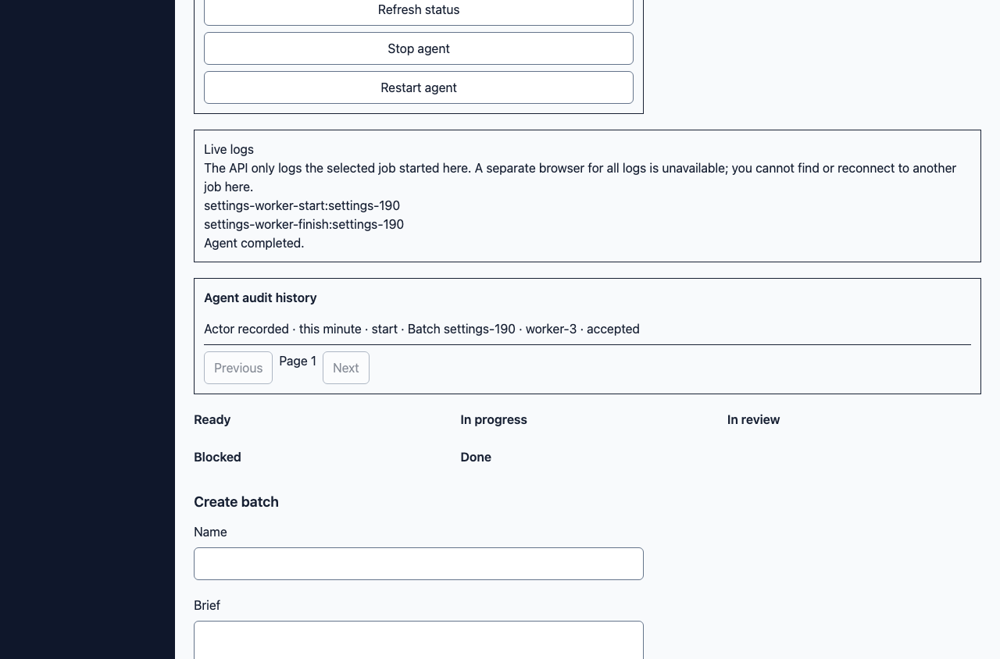
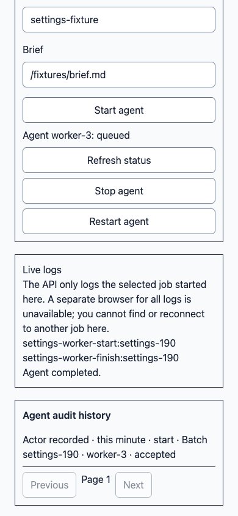

# Worker audit history: real accepted starts

The API controller returns Go `ActionAudit` directly: `ID`, `OrganizationID`,
`ActorID`, `OccurredAt`, `Action`, `Wave`, `JobID`, `Outcome`, `CreatedAt`.
The module previously consumed only the generated lower-camel names. The scoped
adapter now normalizes both shapes; it does not infer actor, time or outcome.
The captured synthetic response is in
`src/modules/waves/fixtures/worker-audit-history.json`.

## Reproduce

```sh
pnpm exec vitest run src/modules/waves/audit-adapter.test.ts src/modules/waves/audit-history.test.tsx src/shared/api/worker-audit-history-contract.test.ts
/Users/zeross/agent-ops/scripts/heavy.sh node scripts/verify/auth-stack.mjs audit
```

The browser signs in through the real UI, selects its organization, follows
Settings → Advanced → Logs, and starts the unchanged allowlisted Settings worker.
It checks HTTP 201, the actual HTTP 200 audit JSON against the job and authenticated
session, two stdout lines, WebSocket completion, and the rendered audit row/time.
Screenshots capture the audit surface at 1280px and 390px with no document overflow.
The actor UUID retains the existing “Actor recorded” display; the regression
compares its source value with the real session account, not a fabricated identity.
“accepted” is the recorded start outcome, not a claimed task success.

The runner restores one database snapshot before each phase. A disposable compiled
client bypasses normalization for the failing control; restoring the adapter must
pass the identical browser command. No interception or token injection is used.
The provider and worker are local fixture boundaries; API, Postgres, production
client and WebSocket are real. Existing Settings verification is unchanged.

Run `1794628806028` passed production and restored production; bypassing the
adapter failed specifically at `AUDIT_ACCEPTED_START_ROW`. All three phases used
snapshot SHA-256 `1c09af6abf02327a64e9831cea1727ac6e853e926260b7dde32c035b562589a7`.
Generated job IDs and action times naturally differ between starts.
Cleanup confirmed zero owned containers, networks, volumes and provider processes.
The full client gate passed 71 test files / 290 tests; the build reported three
bundle-size/performance warnings. Targeted regression passed 10 tests; bypassing
normalization failed 5 of those same tests, including the captured response case.




Ignored raw commands, source hashes, HTTP JSON, browser results and cleanup evidence
are archived under the canonical client `.agent-runs/W19-audit-history-229/`
before cleanup and again afterwards. Raw snapshots and credentials are not curated
for publication. The PR records the tested commit and specific run directory.
